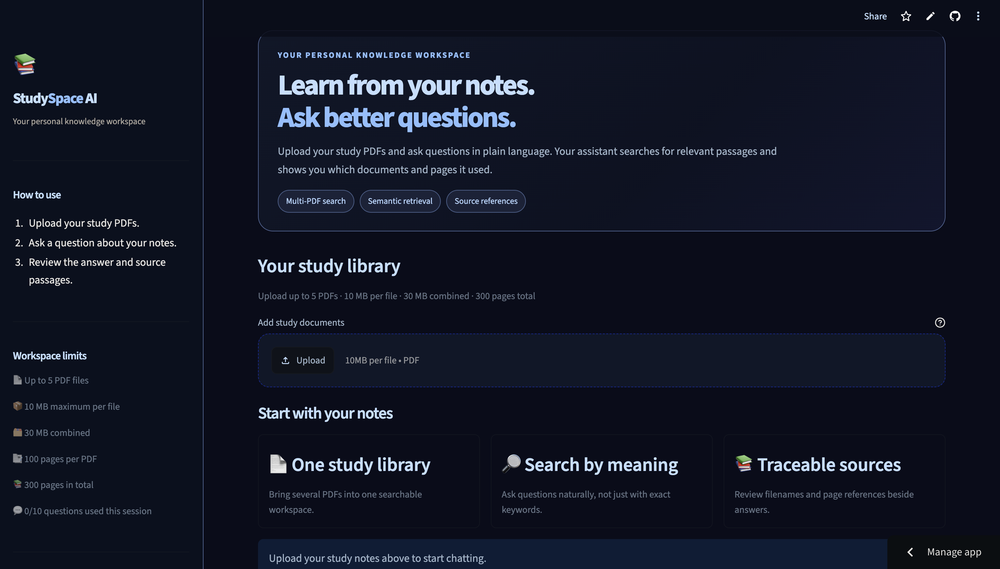
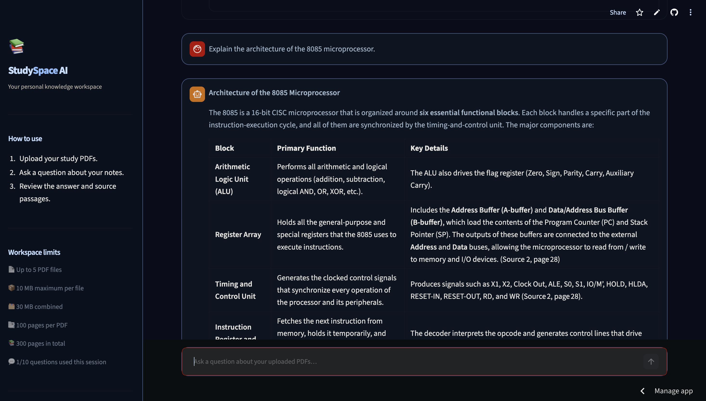
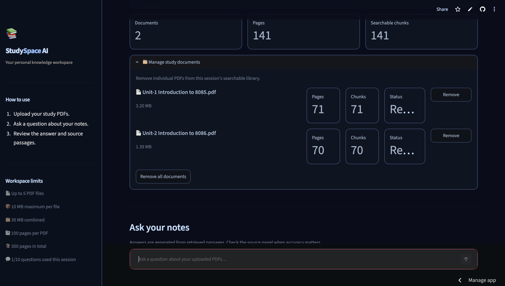
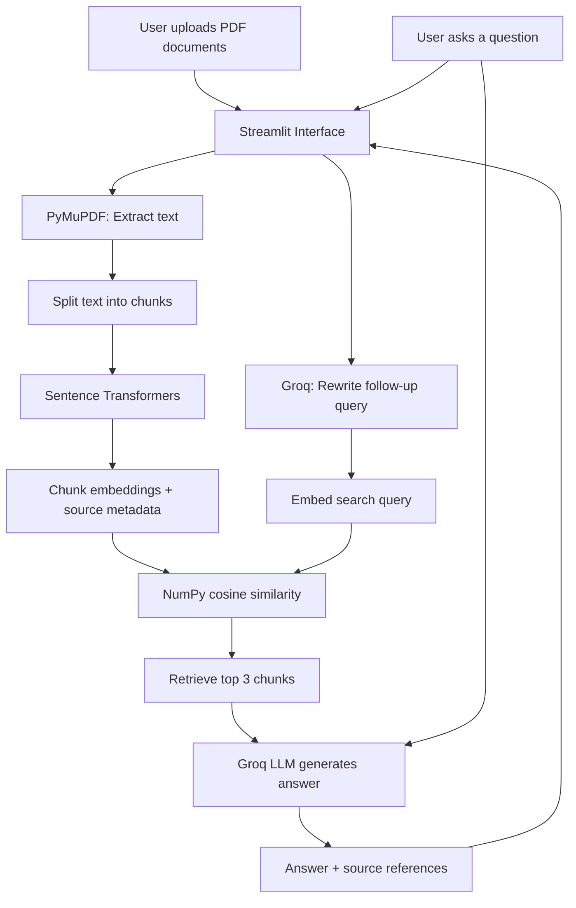

# AI Study Assistant — RAG Chatbot

An AI-powered study assistant that answers questions from uploaded PDF documents using Retrieval-Augmented Generation (RAG).

## 🚀 Live Demo

**Try the application:** (https://ai-study-assistant-ak.streamlit.app/)


## 🖥️ Application Screenshots

### Home Screen


### Chatting with Study Notes


### Retrieved Sources



## ✨ Features

- Upload multiple PDF documents.
- Extract and chunk document text.
- Generate embeddings using Sentence Transformers.
- Retrieve relevant passages through semantic search.
- Generate context-grounded answers using Groq's LLM API.
- Handle follow-up questions using conversational history and query rewriting.
- Display source filenames and page numbers for retrieved passages.
- Use a Streamlit web interface.

## 🛠️ Tech Stack

- **Language:** Python
- **Frontend:** Streamlit
- **PDF Processing:** PyMuPDF
- **Embeddings:** Sentence Transformers
- **Numerical Computing:** NumPy
- **LLM API:** Groq
- **Version Control:** Git and GitHub


## 🏗️ System Architecture



### How It Works

1. **Document ingestion:** Users upload multiple PDFs through the Streamlit interface.
2. **Text extraction:** PyMuPDF extracts text from each page.
3. **Chunking:** The extracted text is divided into overlapping chunks while preserving the source filename and page number.
4. **Embedding generation:** Sentence Transformers converts chunks into numerical vectors.
5. **Semantic retrieval:** The user's question is embedded and compared with document embeddings using cosine similarity. The most relevant chunks are selected.
6. **Answer generation:** Groq receives the question, conversation context, and retrieved passages to generate an answer.
7. **Source display:** The application displays the answer alongside the retrieved document passages and their source metadata.


## 💻 Run Locally

### 1. Clone the repository

```bash
git clone https://github.com/theamankalwar/ai-study-assistant.git
cd ai-study-assistant
```

### 2. Create and activate a virtual environment

```bash
python3 -m venv .venv
source .venv/bin/activate
```

### 3. Install dependencies

```bash
python -m pip install -r requirements.txt
```

### 4. Configure environment variables

Create a `.env` file in the project root:

```dotenv
GROQ_API_KEY=your_groq_api_key
GROQ_MODEL=openai/gpt-oss-20b
```

Obtain your API key from [Groq Console](https://console.groq.com/keys).

**Never commit your `.env` file or expose your API key.**

### 5. Run the application

```bash
python -m streamlit run app.py
```

## ⚠️ Current Limitations

- Scanned PDFs are not supported unless text extraction or OCR is added.
- Retrieval currently uses a simple embedding-similarity approach.
- Generated answers may contain errors and should be checked against their source passages.
- API usage is subject to the provider's limits and policies.

## 🔮 Future Improvements

- Improve retrieval accuracy and document chunking.
- Add OCR support for scanned documents.
- Add more rigorous RAG evaluation.
- Improve page-level citations and answer verification.
- Add persistent chat history and document management.

## 👨‍💻 Author

**Aman Kumar**

- GitHub: [@theamankalwar](https://github.com/theamankalwar)

---

Built as a learning project to understand document processing, embeddings, semantic search, LLM integration, and Retrieval-Augmented Generation.
